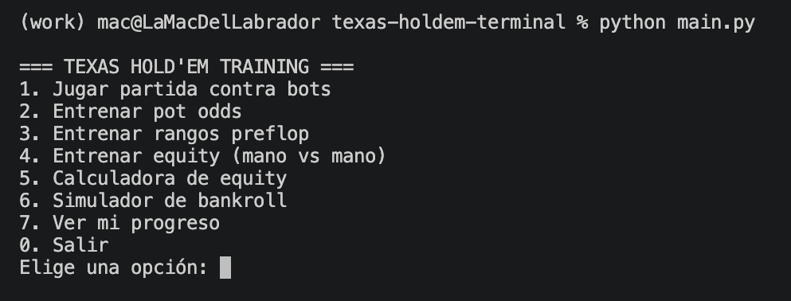
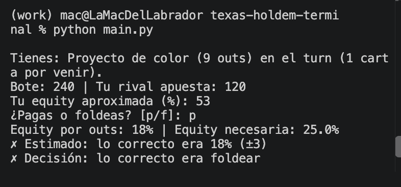

# Coaching para Texas Hold'em


Entrenador de Texas Hold'em en la terminal. Juega contra bots y practica los fundamentos que usan los jugadores serios: pot odds, rangos preflop, equity y gestión de bankroll. Tu progreso queda guardado.



## Lo que incluye

| Módulo | Qué entrena |
|---|---|
| Partida contra bots | Jugar manos completas, con revisión de tus decisiones al final |
| Pot odds y outs | Calcular equity necesaria y decidir si pagar |
| Rangos preflop | Abrir o foldear según tu posición (UTG, HJ, CO, BTN) |
| Equity mano vs mano | Desarrollar intuición de porcentajes |
| Calculadora de equity | Simulación Monte Carlo contra 1 a 5 oponentes |
| Simulador de bankroll | Riesgo de ruina según winrate, desviación y buy-ins |
| Progreso | Historial de aciertos por módulo |



## Instalación

Requiere Python 3.8 o superior.

```bash
git clone https://github.com/ApolloCusi/texas-holdem-training.git
cd texas-holdem-training
pip install -r requirements.txt
python main.py
```

## Cómo usarlo

El menú se maneja escribiendo el número de cada opción. Todos los entrenadores dan retroalimentación inmediata y guardan tu resultado en `progreso.json`, que puedes ver desde "Ver mi progreso".

### Reglas de la partida (simplificadas a propósito)

- Ante fijo de 10 fichas, sin ciegas ni rondas de subidas.
- En cada calle (Flop, Turn, River) eliges pasar, apostar 20 o retirarte.
- Los bots igualan si su equity supera las pot odds.
- Al terminar la mano puedes ver una revisión de tus decisiones.

### Rangos preflop

Los rangos incluidos son una referencia aproximada (6-max, 100bb, todos foldean hasta ti). Se editan en `RANGOS_TEXTO`, dentro de `src/rangos.py`, con notación estándar (`77+`, `ATs+`, `A5s-A2s`, `KQo`).

## Función por dentro

- Las cartas son tuplas `(valor, palo)`.
- El evaluador convierte cada mano de 5 cartas en una tupla comparable `(categoría, desempates...)` y con 7 cartas prueba las 21 combinaciones.
- La equity se calcula con simulación Monte Carlo: se reparten miles de manos completas al azar y se cuentan victorias y empates.
- El riesgo de ruina combina la fórmula teórica con una simulación de trayectorias.

## Tests

```bash
python -m pytest -v
```

## Estructura

```
texas-holdem-training/
├── main.py
├── requirements.txt
├── src/
│   ├── cartas.py       # baraja y lectura de cartas
│   ├── evaluador.py    # evaluación de manos
│   ├── juego.py        # partida y bots
│   ├── revision.py     # revisión de decisiones
│   ├── pot_odds.py     # entrenador de pot odds
│   ├── rangos.py       # entrenador de rangos
│   ├── equity.py       # calculadora y entrenador de equity
│   ├── bankroll.py     # simulador de bankroll
│   ├── progreso.py     # historial en JSON
│   └── menu.py         # menú principal
├── tests/
└── docs/
```

## Hoja de ruta

- [x] Juego jugable contra bots
- [x] Evaluador de manos con tests
- [x] Menú principal
- [x] Entrenador de pot odds y outs
- [x] Entrenador de rangos preflop
- [x] Progreso guardado
- [x] Calculadora de equity (Monte Carlo)
- [x] Revisión de manos
- [x] Simulador de bankroll
- [ ] Rondas de apuestas completas con ciegas y posiciones
- [ ] Rangos vs 3-bet y defensa de ciegas

## Aviso

Proyecto educativo. Los rangos y heurísticas son simplificaciones y no sustituyen el estudio con herramientas profesionales ni la experiencia de juego real.

## Licencia

MIT. Ver [LICENSE](LICENSE).

## Autor

Apollo ([@ApolloCusi](https://github.com/ApolloCusi))